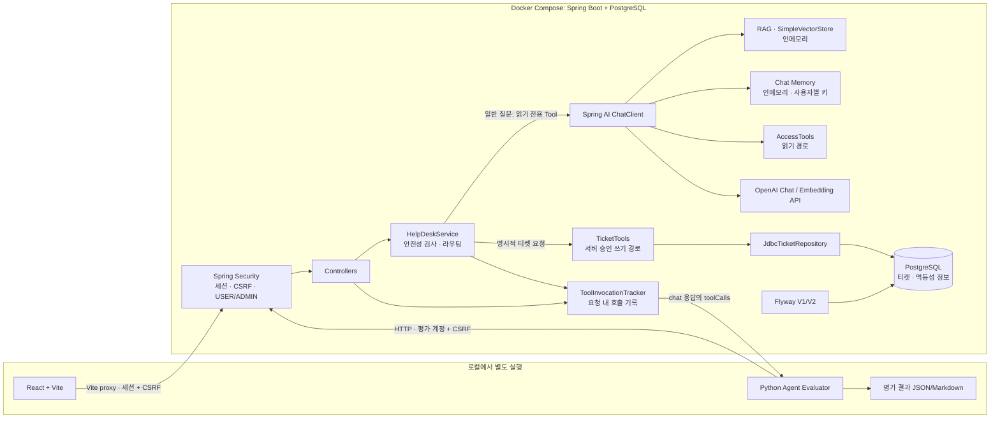

# DevDesk AI — HelpDesk Agent

사내 IT 정책 질문, 권한 상태 조회, 지원 요청 접수를 한 대화 흐름에서 처리하는 **Spring AI 기반 로컬 데모**다. 쉽게 말해, AI는 업무 문서를 찾아 질문에 답하고 실제 권한 조회와 티켓 생성은 서버가 허용한 경로에서만 실행한다.

이 프로젝트에서 보여주는 핵심은 **업무 실행 경계와 검증 방법**이다. 사용자는 세션으로 인증하고, 서버는 인증 principal을 기준으로 API와 티켓 요청자를 구분한다. 티켓은 PostgreSQL에 영속 저장하며 재시도는 Idempotency Key로 처리한다. 실제 IAM·ITSM에는 연결하지 않는다.

| 빠른 확인 | 검증 결과 |
| --- | --- |
| Java | 132개 중 129 통과·3 스킵·실패 0 |
| Python evaluator | 33개 통과(마지막 검증 기준) |
| Docker Live Agent 평가 | 15/15 시나리오·17/17 턴. Tool 선택·인자·실행 각각 6/6 |
| 실행 범위 | 로컬 Docker 데모. 계정·권한 샘플·Chat Memory·Vector Store는 개발용이며 일부 인메모리 |

프로젝트는 **일반 LLM 경로와 티켓 쓰기 경로 분리**, **인증 사용자 기준 접근**, **영속화와 멱등성**, **시나리오 기반 검증**을 중심으로 구성했다. 아래에는 확인된 기능과 제한을 함께 기록한다.

## 해결하려는 문제

정책 안내와 업무 요청을 같은 대화에서 다룰 때 모든 답을 LLM 문장 생성에 맡기면, 권한 상태를 추측하거나 요청 접수를 작업 완료로 표현할 수 있다. DevDesk AI는 **정보 검색, 현재 상태 조회, 쓰기 요청**을 분리한다. 정책 질문에는 사내 Markdown 문서를 검색하고, 상태 조회는 저장소를 읽으며, 쓰기 요청은 승인 전 `PENDING` 티켓까지만 생성한다.

## 기술 스택

- **Backend:** Java 21, Spring Boot 3.5.16, Spring AI 1.1.8 (`ChatClient`, Advisors, Tool Calling, Chat Memory, VectorStore)
- **Model:** OpenAI `gpt-4o-mini` 채팅, `text-embedding-3-small` 임베딩. 호출에는 유효한 API 키가 필요하다.
- **Data:** PostgreSQL·Spring JDBC·Flyway로 티켓 저장. Chat Memory·VectorStore·권한 예시와 개발 계정은 인메모리. 정책 원문은 `src/main/resources/docs/*.md`.
- **Observability:** Micrometer, Actuator, Prometheus registry, Tool audit log.
- **Demo UI / tests:** React·TypeScript·Vite, JUnit 5·AssertJ·Mockito, Python 표준 라이브러리 평가기.

## 전체 아키텍처

RAG는 관련 업무 문서를 찾아 모델 답변에 참고 자료로 제공하는 검색 방식이다. Tool은 권한 조회 같은 정해진 동작을 실행하는 기능이다.



Docker Compose는 Spring Boot와 PostgreSQL만 실행한다. React/Vite와 Python 평가기는 별도 프로세스다. Tool Trace는 서버가 요청 안에서 실행된 Tool을 기록해 API 응답에 담고, Python 평가기는 그 응답과 시나리오를 비교해 결과 파일을 만든다. 평가기는 Tool을 실행하지 않는다.

`/api/ingest`는 정책 문서를 임베딩해 인메모리 VectorStore에 넣는다. `QuestionAnswerAdvisor`가 검색 결과를 모델 문맥에 제공한다. 응답의 `sources`는 답변 후 별도 유사도 검색에서 얻은 파일명이므로, 답변 문장마다 근거가 있다는 증거는 아니다. 상세 구현 흐름은 [기술 회고](docs/portfolio/technical-retrospective.md)를 참고한다.

## 핵심 기능과 설계 판단

| 기능 | 해결하려는 문제와 현재 구현 |
| --- | --- |
| RAG | 정책 문서를 검색해 모델 문맥에 제공한다. `QuestionAnswerAdvisor`, `topK=5`, threshold `0.35`를 사용한다. 검색 hit와 답변 충실도는 별도 평가 대상이다. |
| Memory | 인증 사용자와 세션 ID로 만든 대화 키에 최대 20개 메시지를 유지한다. 저장소는 인메모리다. |
| 인증·인가 | Spring Security 세션·CSRF를 사용한다. principal이 API 사용자 신원이며 USER/ADMIN 역할로 경로를 제한한다. 개발 계정은 환경변수에서 읽는 인메모리 계정이다. |
| 읽기·쓰기 경계 | 권한 조회는 결정형 Access Tool이다. 일반 모델 경로에는 읽기 Tool만 제공하고, 티켓 생성은 서버의 명시적 요청 분기에서만 실행한다. 티켓은 `PENDING` 상태로 저장하며 실제 권한을 부여하거나 장애를 해결하지 않는다. |
| 사용자 범위 | 채팅 body의 legacy `userId`가 principal과 다르면 거부한다. History, 권한 Tool, Memory, `ToolContext`, `requestedBy`는 인증 principal을 기준으로 처리한다. |
| PostgreSQL·멱등성 | JDBC Repository와 Flyway migration을 사용한다. `(requested_by, idempotency_key)` unique 제약과 fingerprint로 재전송을 처리한다. 같은 key·다른 내용은 409다. |
| 입력 안전성 | 입력 길이·일부 Prompt Injection·민감 입력 형식을 Tool/Memory/모델 경로 전에 검사한다. 모든 개인정보나 간접 Injection을 포괄하는 전용 정책 엔진은 아니다. |
| Tool Trace·계측 | `ToolAuditAspect`와 `ToolInvocationTracker`가 Tool 호출·허용된 인자·정리된 결과·성공·지연을 기록한다. Python 평가는 외부에서 API 응답을 판정한다. |
| Fallback | primary 실패 시 별도 fallback client로 한 번 전환한다. `FALLBACK_MODEL` 미설정 시 기본 이름은 primary와 같은 `gpt-4o-mini`다. |

### 실제 오류를 발견하고 처리한 과정

- 검색 threshold `0.30`은 dev set에서 개선됐지만 unseen holdout에서 무관한 질문의 false positive가 발생했다. 이를 적용하지 않고 `0.35`를 유지했다. 실패 사례와 지표는 [RAG 검색 품질 평가](docs/rag-retrieval-quality-evaluation.md)에 남겼다.
- Fine-tuning 자료는 별도 실험 트랙이다. 어떤 fine-tuned adapter도 HelpDesk Agent runtime이나 Live 평가에 포함하지 않는다.

세부 의사결정과 코드 근거는 [기술 회고](docs/portfolio/technical-retrospective.md), 면접 요약은 [이력서·면접 자료](docs/portfolio/resume-and-interview.md)를 참고한다.

## 검증 현황

실제 `/api/chat` 응답을 판정하는 [15개 시나리오](evaluation/agent_scenarios.json)가 있다. HTTP 상태, Tool 사용 여부·선택·핵심 인자·실행 성공, RAG source 파일명, 차단 문구, multi-turn 맥락과 latency를 확인한다. 문자열 기반 판정이므로 모든 동의어·정책 사실성·답변 충실도를 보증하지 않는다.

| 검증 | 마지막 확인 결과 | 범위 |
| --- | --- | --- |
| Java 테스트 | **129 통과, 3 스킵, 0 실패 (132개)** | JUnit 결과 XML에서 확인. 스킵 3개는 opt-in live RAG 점검 |
| Python evaluator 테스트 | **33 통과** | 마지막 확인 기준. fine-tuning 실험 테스트와 별도 |
| Gradle·React 빌드 | 성공 | `build` 및 Vite production build의 마지막 확인 기준 |
| Docker Live Agent 평가 | [15/15 시나리오·17/17 턴](evaluation/results/runs/docker-live-final-20261105-203123-602029/latest.md) | Tool 선택·인자·실행 각 6/6. 단일 실행 결과 |
| RAG source hit | 100% | 기대 출처 문서의 검색 hit. 답변 충실도 전체를 의미하지 않음 |
| 평가 지연시간 | 평균 831.69ms, 중앙값 10.65ms, P95 3,092.71ms | 결정형 API 요청과 모델 요청을 합친 전체 turn latency |
| PostgreSQL 티켓 | 평가 DB에서 3건 확인 | AG-05/06/12 티켓, `PENDING`, 요청자 principal `user1` |
| 별도 QLoRA 파일럿 | 별도 실험, Java Agent 미통합 | 이 결과는 Agent의 모델 성능이나 Live 평가에 포함하지 않음 |

15/15는 정해진 시나리오 세트의 한 차례 Live 평가 결과이며 일반화된 정확도 100%를 뜻하지 않는다. RAG source hit는 기대 출처의 검색 여부를 보며 답변 문장 전체의 근거성을 증명하지 않는다. Tool Trace는 Spring Boot 요청에서 수집되고 Python 평가기가 API 응답을 판정한다.

## 실행 방법

필요 도구는 Docker Engine/Desktop와 Node.js/npm이다. 정책 인제스트·RAG·모델 대화는 OpenAI API를 사용하고 비용이 발생할 수 있다. API Key 없이도 로그인과 결정형 권한·티켓 경로는 확인할 수 있다.

1. 저장소 루트에서 예제 설정을 복사하고 로컬 DB 및 개발 계정 비밀번호를 채운다. `.env.docker.local`은 이미지에 포함되지 않으며 Git에 추가하지 않는다. 모델 호출을 시험할 때만 선택적으로 API Key를 넣는다.

   ```sh
   cp .env.docker.example .env.docker.local
   ```

2. Spring Boot와 PostgreSQL을 빌드·실행한다.

   ```sh
   docker compose --env-file .env.docker.local up --build
   ```

3. Health를 확인한다.

   ```sh
   curl http://127.0.0.1:8080/actuator/health
   ```

4. React 개발 서버는 별도 터미널에서 실행한다.

   ```sh
   cd frontend
   npm install
   npm run dev
   ```

Vite는 `/api`, `/login`, `/logout` 요청을 `localhost:8080`으로 proxy한다. 브라우저에서 표시되는 로그인 계정은 `.env.docker.local`에 넣은 `user1`, `user2`, `admin`이며, 비밀번호는 저장소에 기록하지 않는다. Compose는 API를 localhost에만 노출하고 PostgreSQL 포트는 호스트에 공개하지 않는다.

종료할 때는 `docker compose --env-file .env.docker.local down`을 사용한다. 이 명령은 PostgreSQL named volume을 보존한다. 개발 데이터를 유지하려면 `down -v`를 실행하지 않는다. 정책 인제스트와 모델 대화는 API 호출 비용이 발생할 수 있다.

## API와 인증

보호된 API는 Spring Security 세션을 요구한다. POST와 같은 변경 요청에는 `/api/csrf`에서 얻은 CSRF 토큰도 필요하다. React UI와 Python evaluator가 로그인·쿠키·CSRF 처리를 맡으므로 아래 경로를 익명 `curl`로 호출하는 예시는 동작하지 않는다.

| Method | Path | 권한·설명 |
| --- | --- | --- |
| `GET` | `/api/csrf` | CSRF 토큰 발급 |
| `POST` | `/login` | 세션 로그인 |
| `GET` | `/api/me` | 인증 principal 확인 |
| `POST` | `/api/chat` | USER/ADMIN. 티켓 실행 요청은 UUID `Idempotency-Key` 필요 |
| `GET` | `/api/history?sessionId=...` | USER/ADMIN, principal 기준 본인 기록 |
| `POST` | `/api/ingest` | ADMIN 전용, CSRF 필요, 정책 문서 임베딩 API 호출 가능 |
| `GET` | `/api/admin/tickets` | ADMIN 전용 PostgreSQL 티켓 목록 |
| `GET` | `/api/metrics` | ADMIN 전용 애플리케이션 누적 지표 |
| `POST` | `/logout` | 로그아웃, CSRF 필요 |
| `GET` | `/actuator/health` | 공개되는 최소 Health 응답 |

요청 본문의 `userId`는 인증 신원으로 사용하지 않는다. 값이 제공되고 principal과 다르면 403이다. `toolCalls` 응답은 요청 중 실행된 Tool 이름, 허용된 인자, 결과 상태와 지연을 보여주며 `userId`·ToolContext·티켓 자유 텍스트는 인자 trace에 포함하지 않는다. Tool trace는 서버에서 생성되고 Python evaluator는 응답을 판정해 결과 파일에 저장한다.

## 테스트

```bash
./gradlew test build
python3 -m unittest scripts/test_evaluate_agent.py scripts/test_evaluate_agent_auth.py scripts/test_evaluate_prompt_injection.py
cd frontend && npm install && npm run build
```

마지막으로 확인된 기준은 Java 132개 중 129 통과·3 스킵·0 실패, Python evaluator 33개 통과, Gradle·React 빌드 성공이다. live RAG 진단 테스트는 API Key와 opt-in 환경 변수가 없으면 스킵된다. 이 README 편집 과정에서 테스트를 다시 실행하지 않았다.

## CI

GitHub Actions는 `main` push와 `main` 대상 pull request에서 Java 21 테스트, Python evaluator 단위 테스트, Gradle build를 실행한다. 프런트엔드 production build와 Docker 런타임 검증은 이 CI workflow에 포함되지 않는다.

## RAG Retrieval Evaluation

- Golden Query 기반 deterministic retrieval regression은 외부 API나 secret 없이 CI에서 실행된다.
- Live OpenAI embedding 평가는 명시적으로 opt-in할 때만 실행되며 dev set과 unseen holdout을 분리한다.
- Hit@K, Recall@K, MRR, negative false-positive와 raw similarity score를 함께 진단한다.
- Dev set의 `0.30` 후보가 unseen holdout에서 충분히 일반화되지 않아 production threshold 변경을 보류했다.

상세 결과와 한계는 [RAG Retrieval Quality Evaluation](docs/rag-retrieval-quality-evaluation.md)에 정리했다.

## Agent Evaluation

“Tool이 존재한다”와 “상황에 맞게 Tool을 사용한다”를 구분하기 위해 실제 `/api/chat`을 호출하는 시나리오 평가를 제공한다.

```bash
python3 scripts/evaluate-agent.py \
  --output-dir evaluation/results/runs/my-run-YYYYMMDD-HHMMSS
```

스크립트는 Python 표준 라이브러리만 사용하며 환경변수의 평가 계정 비밀번호로 Spring Security 세션을 만들고 CSRF를 처리한다. 기본적으로 `/api/ingest`를 호출하므로 OpenAI embedding API 비용이 발생할 수 있다. 실행 전 `APP_USER1_PASSWORD`, `APP_USER2_PASSWORD`, `APP_ADMIN_PASSWORD`를 평가 서버와 일치시킨다. 모델 평가에는 유효한 API Key도 필요하다.
평가는 `/api/chat`의 티켓 시나리오에서 실제 DB에 테스트 티켓을 만들 수 있으므로, 개발용 격리 DB에서만 실행한다.

```bash
python3 scripts/evaluate-agent.py \
  --base-url http://localhost:8080 \
  --scenarios evaluation/agent_scenarios.json \
  --output-dir evaluation/results/runs/my-run-after-ingest \
  --skip-ingest
```

`--skip-ingest`는 같은 서버 프로세스에서 문서를 이미 인제스트했을 때만 사용한다. 출력 경로는 실행마다 새 디렉터리로 지정한다. 도구 trace는 `/api/chat` 응답에서 평가기가 읽으며, 평가기 자체가 Tool을 실행하지 않는다. 평가 항목:

- Task Success Rate
- Tool Decision Accuracy
- Tool Selection Accuracy
- Tool Argument Accuracy
- Tool Execution Success Rate
- RAG Source Hit Rate
- Safety Pass Rate
- Multi-turn Pass Rate
- 요청별 latency와 nearest-rank P95

`Tool Decision Accuracy`는 Tool 사용 여부를, `Tool Selection Accuracy`는 기대 Tool의 개수·순서·이름을 평가한다.
`Tool Argument Accuracy`는 scenario에 정의한 핵심 argument만 비교하고, `Tool Execution Success Rate`는 정상 Tool scenario의 업무 성공 여부를 평가한다.
이 지표들은 현재 정의된 Agent evaluation set에 대한 결과이며 모든 요청에 대한 일반 정확도를 의미하지 않는다.

Evaluator 비교 로직은 외부 API 없이 실행할 수 있다.

```bash
python3 -m unittest scripts/test_evaluate_agent.py
```

완료된 실행은 지정한 출력 디렉터리의 `latest.json`과 `latest.md`에 시나리오 성공·실패를 기록한다. 서버 연결 실패, 직접 HTTP 401 또는 인제스트 실패로 중단된 경우에는 파일을 갱신하지 않는다. 모델 제공자의 인증 오류가 서버에서 HTTP 500으로 변환되는 경우에는 평가 실패로 기록될 수 있으므로 출력의 HTTP 상태와 서버 로그를 함께 확인한다.

최종 Docker Live 결과는 [시나리오별 결과](evaluation/results/runs/docker-live-final-20261105-203123-602029/latest.md)와 [상세 JSON](evaluation/results/runs/docker-live-final-20261105-203123-602029/latest.json)에 있다. 이 기록은 15/15 단일 실행이며, 일반적인 정확도 100%를 뜻하지 않는다. 결과에는 합성 테스트 질의와 개발 계정 식별자가 포함된다.

## 구현 범위와 한계

- **로컬 데모다.** 인증 계정은 환경변수로 생성하는 인메모리 개발 계정이며 운영용 IdP·계정 수명주기는 없다. Spring Security는 API 접근을 제한하지만 실제 회사의 IAM/ITSM에는 연결하지 않는다.
- 티켓과 멱등성 정보만 PostgreSQL에 저장된다. 계정·권한 샘플·Chat Memory·Vector Store는 인메모리이며 재시작 뒤 유지되지 않는다.
- 입력 안전성 검사는 일부 민감 패턴과 prompt injection을 차단하지만 모든 개인정보 형식이나 간접 공격을 포괄하는 정책 엔진은 아니다.
- `sources`와 RAG source hit는 답변 문장 전체의 근거 충실도를 검증하지 않는다. AG-10은 평가 기준 개선 사례이며 모델 정확도 향상으로 주장하지 않는다.
- `finetuning/`의 QLoRA 실험은 별도 실험 트랙이며 Agent의 실행 모델에 연결되지 않는다. 결과는 현재 README·Agent 평가에 포함하지 않는다.
- 모델 교체는 미구현이다. OpenAI 종료 공지는 날짜가 붙은 snapshot을 대상으로 하므로 설정 alias에 미치는 영향을 확인해야 하며, Spring AI 1.1.8의 대체 모델 호환성도 검증하지 않았다.

## 향후 개선 방향

이후 우선 과제는 모델 교체 전 호환성 검증, 실제 권한 시스템 연동, 운영 사용자 계정·세션 수명주기, 인메모리 Memory·VectorStore의 보존 정책, DB 백업·복구와 운영 관측이다. 기능을 더하기 전에 기존 평가의 재현성 및 비용·지연 기록을 유지한다.
