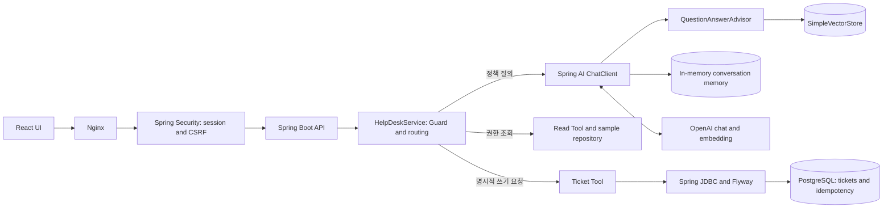
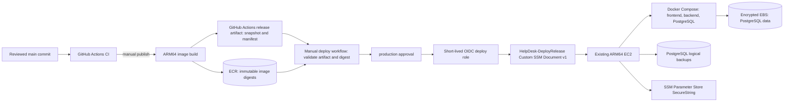

# HelpDesk AI Agent

사내 IT 정책 안내부터 권한 확인과 지원 요청 접수까지 연결하는 업무형 AI Agent 프로젝트입니다.

## Tech Stack
| 영역 | 기술 |
|---|---|
| Backend / AI | Java 21, Spring Boot, Spring AI |
| Frontend | React, TypeScript, Vite, Nginx |
| Data | PostgreSQL, Spring JDBC, Flyway |
| Delivery / Operations | Docker Compose, AWS EC2 ARM64, ECR, EBS, S3, SSM, GitHub Actions, OIDC |
| Monitoring | Actuator, Micrometer; Prometheus·Grafana는 로컬 검증 |

## Highlights
- **실제 Agent 평가 15/15** — OpenAI를 연결한 Docker Live 평가의 단일 실행 결과입니다. [시나리오 결과](evaluation/results/runs/docker-live-final-20261105-203123-602029/latest.md)
- **동일 키 작업 24건 → 티켓 1건** — 격리 PostgreSQL에 24개 작업을 제출하고 8 workers로 처리했습니다.
- **검색용 Mock Embedding 요청 50% 감소** — deterministic mock 30회에서 요청 대리값이 60회에서 30회로 줄었습니다. 실제 API 비용이나 사용자 응답시간 감소를 뜻하지 않습니다.
- **합성 정상 입력 오탐률 2.63% → 0%** — 기존 정상 입력 38건에서 1건 오탐이 0건으로 줄었습니다. 별도 평가셋 결과와 규칙 변경 이력은 [기술 회고의 Privacy 평가](docs/portfolio/technical-retrospective.md#privacy-guard-evaluation)에 구분해 기록했습니다.

**실제 AWS 승인형 자동 CD도 완료했습니다.** [CI](https://github.com/jekim20/HelpDesk-AGENT/actions/runs/45635015092)와 [ECR 게시](https://github.com/jekim20/HelpDesk-AGENT/actions/runs/45575695014) 후 [승인 배포](https://github.com/jekim20/HelpDesk-AGENT/actions/runs/45636757244)를 진행했습니다. 배포 전후 PostgreSQL 컨테이너 ID와 선택한 티켓 fingerprint가 유지됐고, `HD-0001`의 PENDING 상태를 확인했습니다. fingerprint는 일부 티켓 필드만 비교했습니다. 운영 검증 뒤 EC2는 중지했습니다.

## Background
사내 IT 지원을 요청하는 사용자는 정책을 찾고, 자신의 권한 상태를 확인하고, 필요한 경우 지원을 신청합니다. 이 과정이 서로 다른 채널과 절차로 흩어질 수 있다는 업무 시나리오에서 출발해, 안내와 상태 조회, 요청 접수를 한 화면에서 다루는 데모를 기획했습니다. 실제 기업 사용자 인터뷰나 현업 조사를 수행한 프로젝트는 아닙니다.

## Target Users
- **사내 임직원:** IT 정책을 확인하고, 데모 권한 상태를 조회하거나 권한·장애 티켓을 신청합니다.
- **IT 지원 담당자:** 관리자 화면에서 접수된 티켓을 확인합니다. 실제 IAM 승인이나 ITSM 처리는 연동하지 않았습니다.

## Pain Points & Solutions
| Pain Point | Solution | 제공하고자 한 가치 |
|---|---|---|
| IT 정책 탐색이 어렵다 | 정책 문서를 RAG로 검색하고 출처를 답변과 함께 제공 | 근거를 확인할 수 있는 안내 |
| 권한 확인과 지원 신청이 분리돼 있다 | 사용자 기준 권한 조회와 명시적인 티켓 신청 경로를 제공 | 조회와 요청을 한 흐름에서 처리 |
| AI 답변과 실제 업무 상태가 혼동될 수 있다 | 실제 실행 결과로 티켓 상태를 표시하고 권한 신청과 부여를 분리 | 안내 문장과 업무 처리 상태의 구분 |
| 재시도로 중복 요청이 생길 수 있다 | PostgreSQL 제약과 Idempotency-Key로 동일 요청을 멱등 처리 | 중복 티켓 방지 |
| 외부 AI 장애가 일반 업무를 막을 수 있다 | AI/RAG 상태와 핵심 서비스 readiness를 분리 | 비AI 업무 경로의 가용성 유지 |

## Architecture
### Application


VectorStore, 대화 Memory, 샘플 권한 상태는 프로세스 메모리에 있고 티켓과 멱등성 데이터는 PostgreSQL에 저장됩니다.

### AWS and CI/CD


ECR에는 digest 고정 이미지가, GitHub Actions에는 소스 snapshot과 release manifest가 보관됩니다. 배포는 게시된 이미지를 다시 빌드하지 않고 사용합니다. 앱 복구에는 이전 이미지와 호환되는 Compose/운영 bundle이 필요하며 PostgreSQL 데이터는 앱 롤백 대상이 아닙니다. Prometheus·Grafana는 로컬 검증 구성으로 AWS에 설치하지 않았습니다.

## Key Achievements

- **RAG와 업무 Tool 경계:** 정책 질의는 문서 검색과 출처 제공을 거치고, 권한 조회는 정해진 읽기 Tool에서 처리합니다. 티켓 쓰기는 명시적 요청 경로에 두어 모델이 일반 대화 중 상태를 변경하지 않게 했습니다.
- **Agent 추적과 평가:** 시나리오에서 Tool 사용 여부, 선택, 입력값, 실행 결과를 따로 판정하도록 구성했습니다. 알려진 Prompt Injection 입력은 모델 호출 전 Guard 차단으로 평가하며 LLM 공격 성공률과 구분합니다.
- **데이터 정합성과 재시도:** 사용자와 Idempotency-Key를 묶은 DB 제약 및 요청 fingerprint로 재전송을 처리합니다. 같은 키에 다른 내용이 오면 기존 요청에 덮어쓰지 않고 충돌로 처리합니다.
- **보안과 장애 격리:** 세션·CSRF·역할 인가와 principal 기준 데이터 접근을 적용했습니다. AI/RAG 상태는 DB를 포함한 핵심 서비스 readiness와 분리해 관측합니다.
- **검색 결과 재사용:** Advisor가 검색한 문서를 응답 출처에 재사용해 출처 확인용 재검색을 없앴습니다. 회귀 평가에서 문서와 순서를 유지했지만 브라우저 응답시간 개선은 확인되지 않았습니다.
- **ARM64 배포:** 승인된 GitHub Actions가 고정 digest를 SSM 배포 경로에 전달합니다. 기존 티켓 보존은 확인했으며 전체 데이터베이스의 모든 행을 비교한 것은 아닙니다.

## Getting Started & Documentation
### Local run
Docker, Java 21, Node.js/npm이 필요합니다. 저장소 루트에서 환경 예제를 복사하고 필요한 로컬 계정 설정을 채웁니다.

```sh
cp .env.docker.example .env.docker.local
docker compose --env-file .env.docker.local up --build
```

별도 터미널에서 React 개발 서버를 실행합니다.

```sh
cd frontend && npm ci && npm run dev
```

외부 AI 기능은 OpenAI API key 설정이 필요하며 사용량에 따라 비용이 발생할 수 있습니다. 비AI 기능과 결정형 업무 경로는 AI 설정과 별도로 확인할 수 있습니다.

### Tests
저장소 루트에서 실행합니다. Frontend 빌드 명령은 subshell로 실행해 이후 테스트의 작업 디렉터리를 유지합니다.

```sh
./gradlew test --no-daemon
python -m unittest scripts/test_evaluate_agent.py scripts/test_evaluate_agent_auth.py scripts/test_evaluate_prompt_injection.py
(cd frontend && npm ci && npm run build)
npm test --prefix e2e
```

PostgreSQL 통합 테스트는 별도 격리 DB 설정이 필요합니다. 최신 원격 CI 결과 및 test gate는 [CI/CD 문서](docs/deployment/cicd-monitoring.md)를 참고하세요.

### Documentation and run records
- [Current architecture](docs/architecture.md) · [RAG retrieval evaluation](docs/rag-retrieval-quality-evaluation.md)
- [CI/CD and local monitoring](docs/deployment/cicd-monitoring.md) · [AWS operations](docs/deployment/aws-operations.md)
- [Technical retrospective](docs/portfolio/technical-retrospective.md) · [Resume and interview notes](docs/portfolio/resume-and-interview.md)
- [PostgreSQL concurrency test](src/test/java/com/devdesk/agent/TicketRepositoryPostgresIntegrationTest.java) · [Privacy Guard](src/main/java/com/devdesk/agent/UserInputSafetyAdvisor.java)
- [Live Agent evaluation result](evaluation/results/runs/docker-live-final-20261105-203123-602029/latest.md)

상세 혼동행렬, 실패 로그와 운영 증빙은 평가 원본 및 별도 상세 기록에 보존합니다. 공개 문서에서는 재현 가능한 코드와 공개 Actions 실행 기록을 연결했습니다.
