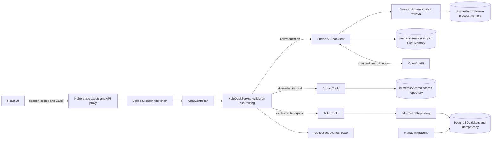

# HelpDesk AI Agent Architecture

> 현재 main의 구조를 설명합니다. 이전 구조와 구현 기록은 날짜가 명시된 기술 회고에서 확인하세요.

## 애플리케이션 요청 흐름

## 경로별 동작

### 입력 검사 및 인증 경계

Browser 요청은 세션과 CSRF 보호를 거쳐 Spring Security에 도달합니다. 서버는 인증 principal을 업무 사용자로 사용합니다. 요청 본문의 legacy userId가 principal과 다르면 거부합니다. Prompt Injection 및 자격증명 입력 검사는 모델·RAG·Tool 경로보다 먼저 수행됩니다.

### 정책 질문

HelpDeskService는 일반 정책 질문을 Spring AI ChatClient로 전달합니다. QuestionAnswerAdvisor가 SimpleVectorStore에서 정책 문서를 검색하고, retrieval 문서는 응답 context에서 출처로 재사용됩니다. 출처는 검색된 문서를 나타내며 답변의 각 문장이 정확하다는 보증은 아닙니다.

정책 문서는 시작 시 인덱싱됩니다. SimpleVectorStore와 대화 Memory는 프로세스 메모리 기반이므로 재시작 후 보존되지 않습니다. 재시작 과정에서 정책 문서를 다시 인제스트하며 embedding provider 설정과 사용 가능성에 의존합니다.

### 읽기와 쓰기

리소스와 의도가 명확한 권한 상태 조회는 LLM 선택 없이 AccessTools로 결정형 실행합니다. 이 도구는 샘플 in-memory 상태를 읽으며 실제 IAM 권한을 변경하지 않습니다.

권한 신청·장애 티켓 쓰기는 서버가 명시적 요청으로 판정한 경로에서만 TicketTools로 연결됩니다. 일반 모델 경로에는 읽기 도구만 제공합니다. 저장 티켓은 PostgreSQL과 Flyway schema를 사용하고 PENDING 상태로 생성됩니다. Idempotency-Key와 사용자별 unique 제약으로 동일 요청 재시도를 처리합니다.

### 응답 및 추적

API 응답은 답변, 검색 출처, Tool trace와 필요 시 구조화된 ticket ID/status를 포함합니다. 자연어 답변의 PENDING 문자열만으로 티켓 배지를 만들지 않습니다. Tool trace는 요청 범위에서 호출 이름, 허용된 인자, 결과와 지연을 기록하고 사용자 질문 및 티켓 자유 텍스트는 trace에 포함하지 않습니다.

## 배포 구성

- 로컬 Docker Compose는 Spring Boot와 PostgreSQL을 실행하고 React 개발 서버는 별도 실행합니다.
- AWS Compose는 Nginx/React, Spring Boot, PostgreSQL을 digest 고정 이미지로 실행합니다. Frontend만 host loopback에 바인딩되어 SSM port forwarding으로 접근합니다.
- PostgreSQL 데이터는 별도 암호화 EBS 경로에 저장되고, 논리 backup은 지정 S3 경로에 올립니다.
- 애플리케이션 프로세스 liveness, DB 중심 핵심 readiness, AI/RAG health는 구분됩니다. AI 장애가 비AI 서비스 readiness를 자동으로 DOWN 처리하지 않습니다.
- GitHub Actions CI는 테스트와 native ARM64 image 검증을 수행합니다. 수동 ECR publish 및 production 승인 기반 SSM deploy는 별도 workflow입니다. 게시 역할과 배포 역할은 OIDC/IAM으로 분리합니다.

## 유지되는 제한

실제 기업 Identity Provider, IAM 권한 부여, ITSM 티켓 시스템은 연결하지 않습니다. 계정·접근권한 표본과 Chat Memory·VectorStore는 영구 저장소가 아닙니다. AWS 배포는 한 차례 검증한 개인 포트폴리오 환경이며 상시 공개 서비스로 운영하지 않습니다.
