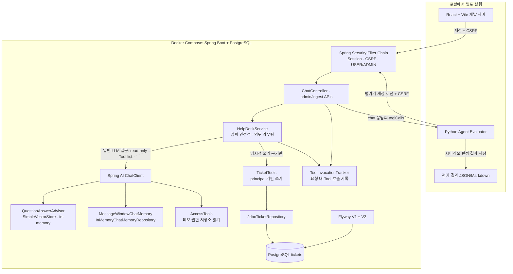

# HelpDesk AI Agent 기술 회고

이 문서는 코드·현재 Git 커밋·최종 Live 결과를 기준으로 작성했다. 커밋은 변경 단위의 출처를 보여주지만 모든 설계 토론이나 작업자의 개인 기여 시간을 증명하지는 않는다. 이 문서는 프로젝트 구현자가 본인의 실제 역할에 맞춰 검토한 뒤 사용해야 한다.

## 1. 시스템 요약

HelpDesk는 React 화면에서 들어온 요청을 Spring Security로 인증하고, `HelpDeskService`가 안전성 검사 후 읽기·쓰기 경로를 선택하는 업무형 Agent 데모다. 일반 질문은 RAG와 Chat Memory를 사용하는 Spring AI 경로로 처리하고, 권한 조회 및 티켓 생성은 서버가 제어하는 Tool 경로에 둔다. 티켓은 PostgreSQL에 저장되며 사용자의 Idempotency Key로 재전송을 처리한다.

### 최종 구조

Compose에는 Spring Boot와 PostgreSQL만 포함된다. React/Vite와 Python evaluator는 별도 프로세스다. Tool Trace는 `ToolInvocationTracker`와 `ToolAuditAspect`가 서버 요청 내 Tool 호출을 추적하고 `/api/chat` 응답에 포함하는 런타임 기능이다. Python evaluator는 외부 HTTP 클라이언트로 시나리오를 보내고 응답의 Tool trace·답변·상태를 판정해 결과 파일을 쓴다. Python 평가기는 Tool을 호출하거나 실행하지 않는다.

경계는 두 가지다. 첫째, 컨트롤러는 인증 principal을 기준으로 신원을 정하고 요청 body의 `userId`가 다르면 거부한다. 둘째, 모델의 일반 질의 경로는 `AccessTools`만 받으며 `TicketTools`는 명시적인 서버 분기에서 실행한다.

저장 범위는 다르다. PostgreSQL에는 티켓 및 키/fingerprint가 남는다. 계정은 `InMemoryUserDetailsManager`, 접근 권한은 데모 저장소, Vector Store는 `SimpleVectorStore`, Chat Memory는 `InMemoryChatMemoryRepository`를 사용하므로 이 데이터들은 프로세스 재시작 후 유지되지 않는다.

## 2. Git 기록에서 확인되는 변경 단위

현재 브랜치 `feature/security-authz`에 다음 기능 커밋이 확인된다.

| 커밋 | 코드에서 확인되는 변경 |
|---|---|
| `24968e3 feat: secure HelpDesk sessions and evaluator` | 세션 인증·인가, principal 기반 요청 처리 및 인증 평가기 기반 |
| `75ac1dc feat: persist helpdesk tickets in PostgreSQL` | Spring JDBC 티켓 Repository, PostgreSQL 스키마와 Flyway 초기 migration |
| `9a7ed68 feat: make ticket creation idempotent` | 요청 키, fingerprint, 사용자별 고유 제약 및 중복 처리 |
| `12a47b8 build: add local Docker environment` | Java 21 이미지와 Compose 기반 DB·앱 실행 구성 |

현 상태에서는 `README.md`, `finetuning/README.md` 수정과 fine-tuning·평가 산출물 등 미커밋 변경도 존재한다. 이번 문서는 그 파일들을 수정하지 않는 별도 초안이다.

## 3. 문제 해결 사례

### 사례 1 — 사용자 ID 위조와 관리자 기능 접근

**문제 발견.** 기존 API가 요청의 `userId`를 신원처럼 사용할 경우, 클라이언트가 다른 사람 ID를 넣어 대화 기록이나 사용자별 권한 범위를 바꿀 수 있었다. 관리자 티켓 조회와 인제스트도 역할 경계가 필요했다.

**원인 분석.** HTTP 요청 본문은 사용자가 직접 통제할 수 있으므로 그 안의 식별자를 인증 증거로 사용할 수 없다. 개인정보 입력 차단이나 프롬프트 안전성 검사는 로그인·권한 검사를 대신하지 않는다.

**대안과 선택.** 단순 프런트엔드 숨김은 서버 API를 직접 호출하면 우회된다. 외부 OAuth/OIDC 서버를 구축하는 것은 데모 규모를 넘어선다. 이 프로젝트에서는 Spring Security 세션 로그인, CSRF, USER/ADMIN 역할을 서버에 적용했다.

**구현.** `SecurityConfig`는 환경 변수로 제공된 개발용 계정을 BCrypt로 등록한다. `/api/chat`, `/api/history`, `/api/me`는 USER 또는 ADMIN, `/api/admin/tickets`와 `/api/ingest`는 ADMIN으로 제한한다. `ChatController` 및 서비스는 인증 principal ID를 사용하며, legacy body `userId`가 principal과 다르면 요청을 거부한다. ToolContext와 티켓 요청자에도 같은 principal ID를 전달한다.

**검증.** 실제 Security FilterChain 통합 테스트와 Docker HTTP 테스트에서 익명 접근 401, 일반 사용자 관리자 접근 403, 로그인 사용자 principal 확인 및 로그아웃 후 차단을 검증했다. 최종 Live 평가에서 관리자 인증·CSRF 처리와 인제스트가 실행된 기록도 확인했다.

**남은 제한.** 계정은 DB/IdP에 저장하지 않는 개발용 인메모리 계정이다. 계정 생명주기, 잠금, 비밀번호 재설정, 운영용 세션 저장소 및 MFA는 없다. 실제 조직의 권한 원장을 연동하지 않았다.

### 사례 2 — 정보 문의가 쓰기 Tool로 이어질 가능성

**문제 발견.** `TicketTools.createTicket()`을 일반 LLM Tool 목록에 넣으면 정보 질문에서도 모델이 티켓 생성을 선택할 수 있다. 시스템 프롬프트에 “생성하지 말라”고 쓰는 것은 실행 권한 경계가 아니다.

**원인 분석.** LLM은 도구 호출을 확률적으로 선택한다. 절차를 설명하는 질문, 부정문, 인용문을 실행 요청으로 잘못 이해할 수 있다. 모델이 쓰기 Tool에 접근할 수 있다면 문서나 대화가 의도 분류를 우회할 위험도 생긴다.

**대안과 선택.** 모든 요청에서 쓰기를 허용한 뒤 프롬프트로 제한하는 방식은 실행 권한을 모델에 맡긴다. 별도 의도 분류 모델·상태 머신은 더 많은 비용과 상태 관리가 필요하다. 우선 서버에서 명시적 실행 요청을 결정형으로 라우팅하고, 일반 모델 경로에서 쓰기 Tool 자체를 제거했다.

**구현.** `HelpDeskService`의 `isTicketRequest()` 결과가 참일 때 서버가 `TicketTools.createTicket()`을 직접 실행한다. 그 외의 `callModel()`은 읽기 전용 `AccessTools`만 등록한다. 생성 경로에는 principal과 유효한 idempotency key를 전달하고, Ticket Tool 결과를 Tool Trace로 남긴다.

**검증.** 정보/절차 문의, 명시적 생성 요청 및 금지 요청 테스트에서 저장소 변경 여부를 확인했다. 최종 Live 결과에서 AG-05·06·12의 세 티켓은 `PENDING` 상태로 저장됐고 AG-10·11에는 `createTicket` trace가 없었다. DB의 요청자와 principal도 `user1`로 일치했다.

**남은 제한.** `isTicketRequest()`는 규칙 기반 휴리스틱이다. 흔하지 않은 표현·복합 인용·문맥상 의도에는 오분류 가능성이 남는다. 별도의 사용자 확인 상태 머신, 요청 취소, 비즈니스 승인 플로우는 없다. 동일한 내용을 새 키로 다시 제출하면 새 신청으로 취급한다.

### 사례 3 — 재시작 시 티켓 데이터 소실

**문제 발견.** 기존 인메모리 티켓 저장소에서는 애플리케이션을 재시작하면 생성 티켓이 사라졌다.

**원인 분석.** 저장소가 프로세스 힙에 있었고, 영속 저장과 스키마 생명주기가 없었다.

**대안과 선택.** Spring Data JPA는 객체 관계 매핑과 더 큰 추상화를 제공하지만 이 프로젝트의 티켓 CRUD는 단순했다. Spring JDBC를 선택하면 SQL과 트랜잭션을 명시적으로 확인하면서 Repository 인터페이스를 유지할 수 있다. 스키마는 코드 실행 전 명시적으로 버전 관리하기 위해 Flyway를 썼다.

**구현.** `JdbcTicketRepository`는 PostgreSQL에 `Ticket` 필드를 저장하고 `HD-0001` 형태의 티켓 번호는 DB sequence에서 발급한다. V1 migration은 테이블·sequence·제약·인덱스를 만들고, 이후 멱등성 컬럼은 V2에서 추가했다. Spring Boot 시작 시 Flyway가 migration을 적용한다.

**검증.** 실제 PostgreSQL 통합 테스트와 Docker에서 애플리케이션 컨테이너 및 PostgreSQL 컨테이너를 다시 시작한 뒤 기존 티켓 조회를 확인했다. 데이터는 named volume과 PostgreSQL에 남았고, 최종 별도 평가 DB에서 티켓 3건을 직접 조회했다.

**남은 제한.** PostgreSQL에 영속화되는 것은 티켓과 멱등성 기록뿐이다. 사용자 계정, Chat Memory, Vector Store와 권한 샘플은 영속화하지 않았다. 백업·복구 및 다중 노드 운영 절차도 구축하지 않았다.

### 사례 4 — 재전송 및 동시 요청으로 티켓 중복 생성

**문제 발견.** 응답이 유실된 뒤 사용자가 같은 신청을 다시 보내거나 네트워크가 요청을 재시도하면 티켓이 중복 생성될 수 있었다.

**원인 분석.** 서버는 같은 문장이 의미적으로 같은 요청인지 안정적으로 알 수 없다. 문장·리소스만 기준으로 중복 제거하면 정당한 별도 신청까지 막는다. 인메모리 중복 체크는 여러 요청/서버 인스턴스 사이에서 원자성을 보장하지 않는다.

**대안과 선택.** 요청 텍스트만 해시하는 방식은 별도 신청 구분을 잃는다. 애플리케이션 메모리 잠금은 재시작과 다중 인스턴스에서 효력이 없다. 클라이언트가 하나의 논리적 제출에 UUID `Idempotency-Key`를 발급하고, 같은 제출을 재시도할 때 그 값을 유지한다. DB 고유 제약으로 사용자별 key를 원자적으로 보호한다.

**구현.** 티켓 생성 요청은 `Idempotency-Key`를 요구한다. Repository는 `(requested_by, idempotency_key)` unique constraint와 트랜잭션을 사용하며, 같은 key의 내용은 정규화된 주요 필드의 SHA-256 fingerprint와 비교한다. 같은 내용이면 기존 티켓을 반환하고, 다른 내용이면 409 충돌을 반환한다. 서로 다른 사용자는 같은 키를 독립적으로 사용할 수 있다. DB sequence는 동시 ID 중복도 막는다.

**검증.** 실제 DB 테스트에서 같은 키·같은 본문 재전송, 같은 키·다른 본문 409, 다른 키 신규 생성, 사용자 간 격리, 서버 재시작 후 재시도 및 동시 요청을 검증했다. Docker runtime에서는 동일 key 동시 12요청에도 티켓 한 건만 생성됨을 확인했다. Live 최종 평가에서는 세 티켓에 서로 다른 key가 저장됐다.

**남은 제한.** Key가 없으면 쓰기 요청을 거부하므로, 오래된 API 클라이언트는 명시적으로 key 지원을 추가해야 한다. Idempotency는 동일 key에만 적용되며 의미상 같은 신청을 새 key로 보내는 경우는 막지 않는다. Key 보존 기간 정책, 클라이언트의 오프라인 재시도 및 장기 key 정리는 후속 과제다.

## 4. React·세션·CSRF 연결

브라우저는 세션 쿠키를 자동으로 보내고, 변경 요청에는 CSRF 쿠키에서 읽은 토큰을 헤더로 함께 전달한다. CSRF 보호를 비활성화하지 않았다. USER와 ADMIN 화면 구분은 UI 편의일 뿐이며, 실제 권한 판정은 Spring Security에서 수행한다. 사용자 이름 표시용 `/api/me` 응답이 있어도 클라이언트 값은 권한 근거로 취급하지 않는다.

Vite proxy는 개발 Origin을 단순화하여 쿠키와 API를 연결한다. 다만 Docker Live Agent 결과는 React 브라우저 UI를 거친 결과가 아니다. UI에서 로그인·세션 유지·권한별 화면을 검증한 기록은 별도의 브라우저 검증과 구분해야 한다.

## 5. 평가 설계와 실제 결과

### 최종 Docker Live E2E

근거 파일: `evaluation/results/runs/docker-live-final-20261105-203123-602029/latest.json` 및 같은 디렉터리의 보고서.

- 15개 시나리오 중 15개 통과, 17개 턴 중 17개 통과.
- Tool 선택 6/6, 인자 6/6, 실행 6/6.
- RAG source hit 100%, safety 100%, multi-turn 100%로 기록.
- 전체 요청 latency 평균 831.69 ms, 중앙값 10.65 ms, P95 3,092.71 ms.
- 평가 종료 뒤 PostgreSQL에서 티켓 3건을 확인: `HD-0001` DEV_DB ACCESS_REQUEST, `HD-0002` VPN INCIDENT, `HD-0003` PROD_DB ACCESS_REQUEST. 모두 요청자 `user1`, 상태 `PENDING`, 서로 다른 멱등성 키.
- AG-10과 AG-11은 티켓 생성 Tool 호출 없이 통과.
- 대화 모델 계측치는 6회 호출, 2,555 prompt tokens, 352 completion tokens. 임베딩 토큰은 이 계측에 포함되지 않는다.

요청 latency 통계에는 결정형 Tool 경로, 서버 처리, 모델 응답이 섞여 있다. 중앙값 10.65 ms는 대부분 빠른 결정형 경로가 포함된 aggregate로 해석해야 하며 순수 LLM 응답시간으로 주장하지 않는다. 반대로 P95 3.09초도 전체 요청 분포의 값이지 단일 모델 호출 지연을 고립해 측정한 결과는 아니다.

### AG-10 평가기 개선

기존 2026-11-05 평가에서 AG-10 응답은 제공된 문서에 야간 GPU 사용 정책이 없다고 정확히 설명했다. 당시 판정은 `확인할 수 없`, `찾을 수 없`, `모르` 등 좁은 문구 목록을 문자열로 찾았기 때문에 의미상 적절한 문장이 실패로 분류됐다. 이는 해당 실행의 RAG source hit나 15개 시나리오 중 나머지 14개와 구분되는 evaluator false negative였다.

평가기 v2는 질문 주제(GPU/야간)를 확인하고, 답변이 근거 자료에 없음을 해당 주제와 연결해 표현하는지, 근거 없는 구체 정책을 확정적으로 제시하지 않는지를 규칙으로 판정한다. 별도 유료 LLM Judge는 사용하지 않았다. 이 수정은 **평가 기준의 타당성 개선**이지 모델 정확도 향상이 아니다.

### 지표 해석의 한계

- source hit는 예상 문서가 검색 결과에 들어왔는지를 보며, 생성 문장 하나하나의 근거 여부를 증명하지 않는다.
- 15/15는 같은 평가 세트의 단일 수행 결과이며, 일반화된 정확도 100%가 아니다.
- 결정형 Tool의 성공률과 LLM 답변 정확도는 별도 지표다.
- API 토큰 계측은 임베딩 사용량을 포함하지 않아 전체 비용 추정에 쓸 수 없다.
- 평가 DB의 세 티켓은 테스트 결과이지 실제 고객/직원 업무 성과가 아니다.

## 6. 검증 상태

최종 프로젝트 기준선으로 기록된 결과는 Java 132 테스트 중 129 pass, 3 skipped, 0 failed; Python evaluator 33 pass; Gradle 및 React 빌드 성공이다. 실제 PostgreSQL 통합 테스트, 재시작 보존, Docker health/auth/idempotency 검증도 앞선 작업에서 수행됐다. 이 문서 작성 자체에서는 전체 테스트를 다시 실행하지 않았다.

실행 증거가 저장되는 경로는 [최종 Live run](../../evaluation/results/runs/docker-live-final-20261105-203123-602029/)이며, 기존 `README.md`, fine-tuning 자료, 과거 결과는 이번 초안에서 변경하지 않았다.

## 7. 모델 종료 일정과 교체 계획

현재 `src/main/resources/application.yml`의 기본 채팅 모델은 `gpt-4o-mini`이고 fallback도 환경변수 기본값으로 같은 이름이다. 임베딩 모델은 `text-embedding-3-small`이다.

OpenAI 공식 deprecation 표는 GPT-4o mini snapshot `gpt-4o-mini-2024-07-18`의 종료일을 2027-01-14로 표시하고 권장 대체 모델을 `gpt-6-luna`로 안내한다. [공식 deprecation 안내](https://developers.openai.com/api/docs/deprecations). 저장소 설정은 snapshot ID가 아니라 `gpt-4o-mini` alias이므로, 실제 종료 영향은 alias 동작과 계정별 제공 모델을 확인해야 한다. OpenAI 모델 문서는 GPT-6 Luna의 Chat Completions function calling에 `reasoning_effort: none` 조건을 명시한다. [GPT-6 Luna 모델 문서](https://developers.openai.com/api/docs/models/gpt-6-luna). 프로젝트의 Spring AI 1.1.8에서 이 옵션 전달과 모델 호환성은 테스트하지 않았으며 모델 교체도 구현하지 않았다. 최신 Spring AI 문서에 reasoning effort 설정 항목이 있더라도, 이는 프로젝트가 사용하는 1.1.8 버전에서 지원된다는 증거가 아니다. [Spring AI OpenAI Chat 문서](https://docs.spring.io/spring-ai/reference/api/chat/openai-chat.html).

권장 교체 계획:

1. 별도 브랜치에서 모델/옵션을 환경별 설정으로 분리하고 primary/fallback 일치 문제를 점검한다.
2. Spring AI 1.1.8이 전송하는 Chat Completions 옵션에서 `reasoning_effort=none` 지정이 가능한지 공식 API와 해당 버전 의존성 기준으로 확인한다. Responses API 전환이 필요하면 별도 범위·회귀 계획을 세운다.
3. 개발 계정에서 비용 상한을 설정하고 호출 1회로 요청/응답, JSON/Tool Calling, 토큰 계측을 smoke test 한다.
4. 모델별 고정 시나리오 평가를 수행한다: Tool 선택/인자/실행, 정보 문의와 거부 문맥, AG-10 근거 경계, multi-turn memory, 한국어 출력, 지연시간·토큰·비용.
5. Live 15개 시나리오를 새 고유 디렉터리에 실행하고 이전 결과와 별도 비교한다. 평가 기준은 고정한다.
6. 모델 alias 가용성, 계정 접근 권한 및 API 가격은 실행 시점의 공식 문서와 계정에서 재확인한다.

이번 문서화에서는 모델 변경 및 유료 호출을 하지 않았다.

## 8. 남은 기술 과제

우선순위가 높은 후속 과제는 운영용 IdP/계정 수명주기, 권한 데이터의 실제 시스템 연계, Memory·Vector Store의 생명주기와 사용자 격리, 사용자 확인 및 업무 승인이 필요한 쓰기 플로우, 비용이 포함된 모델별 평가, 운영용 로그·메트릭·추적/경보 및 DB 백업·복구 계획이다. 이들은 현재 구현되어 있다고 주장하지 않는다.
